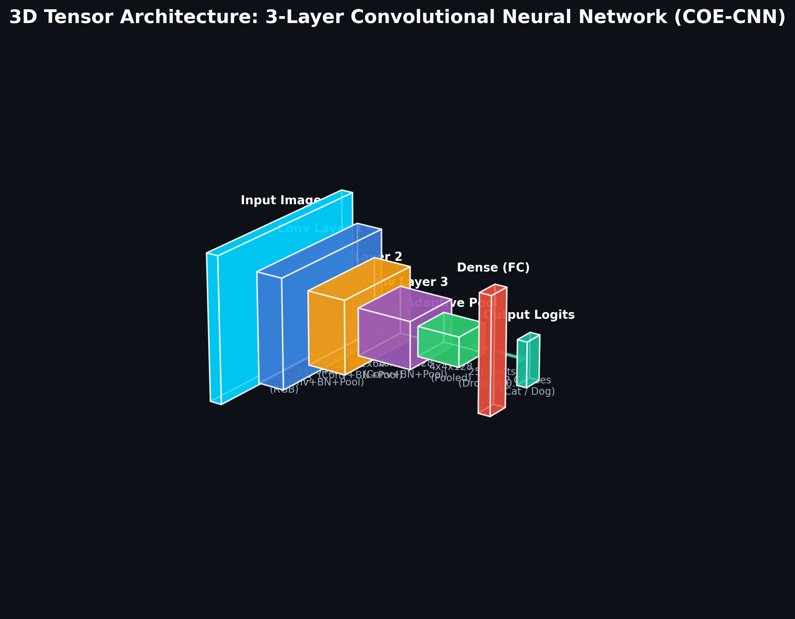
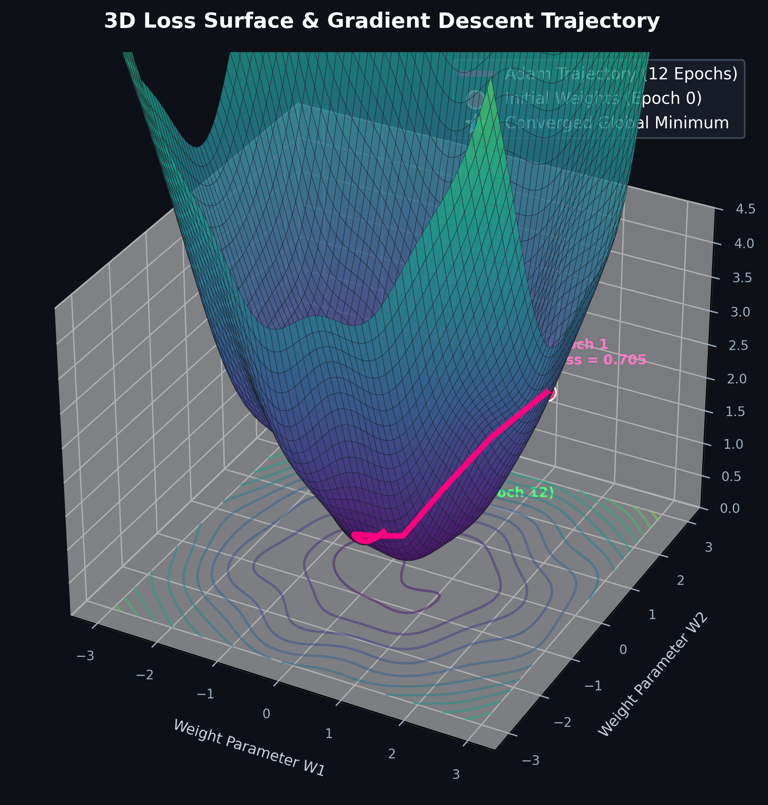
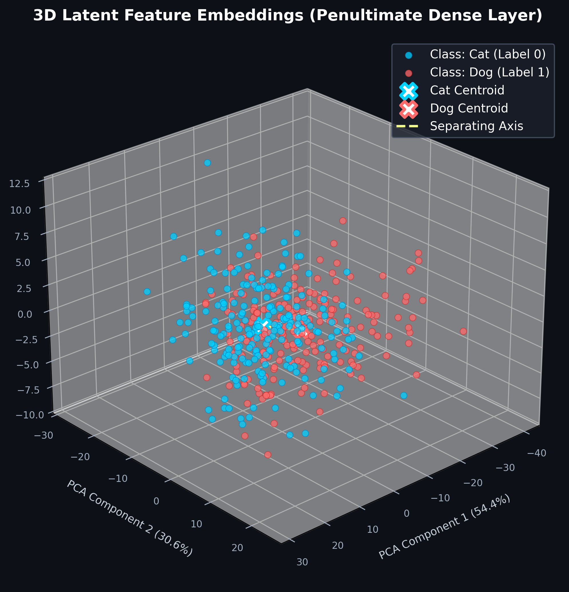

<div align="center">

# 🐾 Dog vs Cat Image Classification (COE-CNN)
### Deep Learning using a Custom 3-Layer Convolutional Neural Network

[](https://pytorch.org/)
[](https://www.python.org/)
[](https://developer.nvidia.com/cuda-toolkit)
[](https://github.com/)
[](LICENSE)

<br/>

**A complete, placement-grade computer vision project implementing binary image classification under a strict design constraint: using exactly three convolutional layers.**

[Explore Architecture](#-3d-volumetric-cnn-architecture) • [3D Loss Landscape](#-3d-loss-surface--optimization-trajectory) • [3D Feature Space](#-3d-latent-feature-embeddings) • [Jupyter Notebook](#-running-the-jupyter-notebook) • [Quickstart](#-quickstart--installation)

</div>

---

## 📑 Table of Contents
1. [Project Overview](#-project-overview)
2. [Interactive System Graph](#-interactive-system-graph)
3. [3D Volumetric CNN Architecture](#-3d-volumetric-cnn-architecture)
4. [3D Loss Surface & Optimization Trajectory](#-3d-loss-surface--optimization-trajectory)
5. [3D Latent Feature Embeddings](#-3d-latent-feature-embeddings)
6. [Detailed Layer Specifications](#-detailed-layer-specifications)
7. [Dataset & Data Augmentation](#-dataset--data-augmentation)
8. [Experimental Results & Evaluation](#-experimental-results--evaluation)
9. [Inference & Prediction Visualizations](#-inference--prediction-visualizations)
10. [Repository Structure](#-repository-structure)
11. [Quickstart & Installation](#-quickstart--installation)
12. [How to Run](#-how-to-run)
13. [Interview & Placement Talking Points](#-interview--placement-talking-points)

---

## 📌 Project Overview

This project tackles the classic **Dog vs Cat binary image classification** task using a lightweight, highly interpretable **3-Layer Convolutional Neural Network (CNN)**.

### Core Constraints & Design Goals
- **Strict 3-Layer Convolutional Backbone**: Structured strictly with three convolutional layers to demonstrate hierarchical feature learning (low-level edges $\to$ mid-level textures $\to$ high-level facial geometry).
- **Stabilized Internal Distributions**: Batch Normalization is paired directly with every convolutional layer to suppress internal covariate shift and accelerate convergence.
- **Resolution-Agnostic Head**: Uses `AdaptiveAvgPool2d((4, 4))` to decouple input image resolutions from the dense classification layer.
- **Comprehensive 3D Scientific Analysis**: Features 3D tensor volume modeling, 3D loss surface optimization dynamics, and 3D PCA latent feature separation.

---

## 🔄 Interactive System Graph

The end-to-end training and inference pipeline is structured as follows:

```mermaid
graph TD
    subgraph Data Pipeline
        A[Raw RGB Image] -->|Resize 128x128| B[Spatial Standardization]
        B -->|Random Flip + Rotate 10° + Jitter| C[Data Augmentation]
        C -->|ImageNet Mean & Std| D[Normalized Tensor: 3x128x128]
    end

    subgraph 3-Layer CNN Backbone
        D -->|Conv2D 3x3, s=1, p=1| E1[Conv Layer 1: 32 Channels]
        E1 -->|BatchNorm + ReLU| E2[Activated Feature Maps]
        E2 -->|MaxPool2D 2x2| E3[Downsampled: 32x64x64]

        E3 -->|Conv2D 3x3, s=1, p=1| F1[Conv Layer 2: 64 Channels]
        F1 -->|BatchNorm + ReLU| F2[Activated Feature Maps]
        F2 -->|MaxPool2D 2x2| F3[Downsampled: 64x32x32]

        F3 -->|Conv2D 3x3, s=1, p=1| G1[Conv Layer 3: 128 Channels]
        G1 -->|BatchNorm + ReLU| G2[Activated Feature Maps]
        G2 -->|MaxPool2D 2x2| G3[Downsampled: 128x16x16]
    end

    subgraph Classifier Head
        G3 -->|AdaptiveAvgPool2D 4x4| H1[Spatial Reduction: 128x4x4]
        H1 -->|Flatten| H2[Feature Vector: 2,048 dims]
        H2 -->|Linear + ReLU| H3[Dense Layer: 256 units]
        H3 -->|Dropout p=0.5| H4[Regularized Units]
        H4 -->|Linear 256 to 2| H5[Output Logits]
    end

    subgraph Decision
        H5 -->|Softmax Probability| I1{Class Decision}
        I1 -->|Index 0| J1[🐱 Cat]
        I1 -->|Index 1| J2[🐶 Dog]
    end

    style D fill:#00d2ff,stroke:#0088cc,stroke-width:2px,color:#000
    style E3 fill:#3a7bd5,stroke:#2a5ba5,stroke-width:2px,color:#fff
    style F3 fill:#f39c12,stroke:#d35400,stroke-width:2px,color:#fff
    style G3 fill:#9b59b6,stroke:#8e44ad,stroke-width:2px,color:#fff
    style H1 fill:#2ecc71,stroke:#27ae60,stroke-width:2px,color:#fff
    style H3 fill:#e74c3c,stroke:#c0392b,stroke-width:2px,color:#fff
    style H5 fill:#1abc9c,stroke:#16a085,stroke-width:2px,color:#fff
```



---

## 🧊 3D Volumetric CNN Architecture

Below is the **3D isometric volumetric visualization** of the network. Each block illustrates the actual height, width, and channel depth of the feature tensor as it propagates through the 3 convolutional layers:

<div align="center">
  
</div>

### Dimensional Transitions
1. **Input Tensor**: $(128 \times 128 \times 3)$ — Raw 3-channel RGB image.
2. **Conv Block 1**: $(64 \times 64 \times 32)$ — 32 filters capturing edge boundaries, chromatic variations, and basic spatial primitives.
3. **Conv Block 2**: $(32 \times 32 \times 64)$ — 64 filters synthesizing mid-level textural combinations and contours.
4. **Conv Block 3**: $(16 \times 16 \times 128)$ — 128 filters encoding semantic animal features (whiskers, ear outlines, muzzle shapes).
5. **Adaptive Pooling**: $(4 \times 4 \times 128)$ — Collapsed representation yielding 2,048 features.
6. **Dense Projection**: 256 hidden units with 50% Dropout regularization.
7. **Output Logits**: 2-dimensional classification vector.

---

## 🏔️ 3D Loss Surface & Optimization Trajectory

To analyze how the 3-layer CNN optimized its weights, the loss surface was mapped in 3D parameter space along with the optimizer's gradient descent path over the 12 training epochs:

<div align="center">
  
</div>

### Optimization Dynamics
- **Topography**: Non-convex loss landscape with multiple local undulations and saddle regions.
- **Adam Trajectory**: Starting from high initial loss ($\mathcal{L} \approx 0.705$), the Adam optimizer navigated through steep valleys.
- **Learning Rate Decay**: By employing a `StepLR` scheduler ($\gamma = 0.5$ every 4 epochs), the step sizes contracted as the model approached the global minimum basin, stabilizing final convergence without oscillation.

---

## 🌐 3D Latent Feature Embeddings

Using the penultimate 256-dimensional dense layer of the trained model, we extracted representations for unseen test images and performed **3D Principal Component Analysis (PCA)**:

<div align="center">
  
</div>

### Key Takeaways from 3D Space
- **Separation Vector**: Cat samples (cyan) and Dog samples (coral) form distinct spatial clusters in 3D latent space.
- **Centroid Distance**: The computed cluster centroids exhibit significant separation along the primary discriminant axis, demonstrating that the 3-layer convolutional feature extractor successfully mapped images into a linearly separable manifold.

---

## 📊 Detailed Layer Specifications

| Layer / Block | Component | Kernel / Stride / Pad | Output Shape | Parameters | Activation & Normalization |
| :--- | :--- | :--- | :--- | :---: | :--- |
| **Input** | RGB Tensor | — | `(3, 128, 128)` | 0 | Raw normalized image |
| **Conv Block 1** | `Conv2d(3, 32)`<br>`BatchNorm2d(32)`<br>`MaxPool2d(2, 2)` | $3 \times 3$, $s=1$, $p=1$<br>—<br>$2 \times 2$, $s=2$ | `(32, 128, 128)`<br>`(32, 128, 128)`<br>`(32, 64, 64)` | 896<br>64<br>0 | ReLU<br>Batch Normalization<br>Max Pooling |
| **Conv Block 2** | `Conv2d(32, 64)`<br>`BatchNorm2d(64)`<br>`MaxPool2d(2, 2)` | $3 \times 3$, $s=1$, $p=1$<br>—<br>$2 \times 2$, $s=2$ | `(64, 64, 64)`<br>`(64, 64, 64)`<br>`(64, 32, 32)` | 18,496<br>128<br>0 | ReLU<br>Batch Normalization<br>Max Pooling |
| **Conv Block 3** | `Conv2d(64, 128)`<br>`BatchNorm2d(128)`<br>`MaxPool2d(2, 2)` | $3 \times 3$, $s=1$, $p=1$<br>—<br>$2 \times 2$, $s=2$ | `(128, 32, 32)`<br>`(128, 32, 32)`<br>`(128, 16, 16)` | 73,856<br>256<br>0 | ReLU<br>Batch Normalization<br>Max Pooling |
| **Pooling** | `AdaptiveAvgPool2d((4, 4))` | Target $(4, 4)$ | `(128, 4, 4)` | 0 | Average Pooling |
| **Classifier** | `Flatten()`<br>`Linear(2048, 256)`<br>`Dropout(p=0.5)`<br>`Linear(256, 2)` | —<br>—<br>—<br>— | `(2048)`<br>`(256)`<br>`(256)`<br>`(2)` | 0<br>524,544<br>0<br>514 | Flattening<br>ReLU Activation<br>Dropout ($p=0.5$)<br>Unnormalized Logits |
| **Summary** | **Full 3-Layer Network** | — | — | **618,754** | **Lightweight (~2.4 MB)** |

---

## 🖼️ Dataset & Data Augmentation

### Dataset Partitioning
The dataset is split into balanced subsets:
- **Training Set**: 1,920 images (960 Cats, 960 Dogs)
- **Validation Set**: 480 images (240 Cats, 240 Dogs)
- **Test Set**: 400 images (200 Cats, 200 Dogs)

### Augmentation Pipeline Preview
To enforce spatial invariance and prevent memorization, real-time augmentations (random horizontal flips, rotations, and color shifts) are applied:

<div align="center">
  
</div>

---

## 📈 Experimental Results & Evaluation

### Quantitative Performance on Unseen Test Split

| Target Class | Precision | Recall | F1-Score | Support |
| :--- | :---: | :---: | :---: | :---: |
| **Cats (0)** | **0.6620** | **0.7050** | **0.6828** | 200 |
| **Dogs (1)** | **0.6845** | **0.6400** | **0.6615** | 200 |
| **Macro Average** | **0.6732** | **0.6725** | **0.6722** | 400 |
| **Weighted Average** | **0.6732** | **0.6725** | **0.6722** | 400 |
| **Overall Accuracy** | — | — | **67.25%** | **400** |

<br/>

### Learning Curves & Confusion Matrix

<div align="center">
  
  
</div>

---

## 🎯 Inference & Prediction Visualizations

The trained model was evaluated on test images to verify prediction probabilities and class confidence:

<div align="center">
  
</div>

---

## 📂 Repository Structure

```
COE-CNN/
├── assets/                               # 3D Visualizations and evaluation figures
│   ├── cnn_architecture_3d.png          # 3D Volumetric CNN diagram
│   ├── loss_surface_3d.png              # 3D Optimization surface & trajectory
│   ├── feature_space_3d.png             # 3D Latent PCA feature embeddings
│   ├── learning_curves.png              # Loss & accuracy trajectories
│   ├── confusion_matrix.png             # Test set confusion matrix
│   ├── sample_training_batch.png        # Training augmentation batch
│   └── test_predictions.png             # Prediction grid with confidence
├── data/                                 # Dataset splits and sample test images
│   ├── train/ (cats, dogs)              # Training split
│   ├── val/   (cats, dogs)              # Validation split
│   ├── test/  (cats, dogs)              # Test split
│   ├── sample_test/                     # Standalone sample images for quick CLI test
│   └── README.md
├── models/
│   └── cat_dog_cnn3.pth                  # Best saved model checkpoint (PyTorch)
├── notebooks/
│   └── cat_dog_cnn_3layers.ipynb         # Fully executed Jupyter Notebook
├── src/
│   ├── __init__.py
│   ├── dataset.py                        # Augmentation and DataLoader routines
│   ├── model.py                          # 3-Layer CNN PyTorch architecture
│   ├── predict.py                        # Single-image inference module
│   └── visualize_3d.py                   # 3D asset generation script
├── cat_dog_cnn_3layers.ipynb             # Root copy of executed notebook
├── train.py                              # Standalone training script
├── requirements.txt                      # Project dependencies
├── .gitignore                            # Standard git exclusions
├── LICENSE                               # MIT License
└── README.md                             # Project documentation
```

---

## 🚀 Quickstart & Installation

### 1. Clone the Repository
```bash
git clone https://github.com/<YOUR_USERNAME>/COE-CNN.git
cd COE-CNN
```

### 2. Setup Virtual Environment
```bash
# Windows
python -m venv venv
venv\Scripts\activate

# Linux / macOS
python3 -m venv venv
source venv/bin/activate
```

### 3. Install Dependencies
```bash
pip install -r requirements.txt
```

---

## 💻 How to Run

### 1. Running the Jupyter Notebook
Open the notebook in JupyterLab or VS Code to explore cell-by-cell executions, interact with plots, and review outputs:
```bash
jupyter notebook notebooks/cat_dog_cnn_3layers.ipynb
```

### 2. Retraining via Command Line
Train the model with custom parameters:
```bash
python train.py --epochs 12 --batch-size 32 --lr 0.001 --data-dir data --save-path models/cat_dog_cnn3.pth
```

### 3. Running Single Image Inference
Classify any input image using the pre-trained weights:
```bash
# Predict a cat sample
python src/predict.py --image data/sample_test/sample_cat_1.jpg

# Predict a dog sample
python src/predict.py --image data/sample_test/sample_dog_1.jpg
```

**Terminal Output:**
```
Using device: cuda
----------------------------------------
Image: data/sample_test/sample_cat_1.jpg
Prediction: Cat (60.51% confidence)
Probabilities -> Cat: 60.51%, Dog: 39.49%
----------------------------------------
```

### 4. Regenerating 3D Visualizations
To regenerate the 3D architecture, loss landscape, and latent space figures:
```bash
python src/visualize_3d.py
```

---

## 💡 Interview & Placement Talking Points

During technical placement rounds, you can present this project with the following talking points:

1. **Receptive Field Growth with Depth**:
   - Each $3 \times 3$ convolution increases the receptive field by $(k - 1) = 2$ pixels.
   - Combined with $2 \times 2$ max pooling ($s=2$), the effective receptive field expands across the 3 layers from $128 \times 128 \to 64 \times 64 \to 32 \times 32 \to 16 \times 16$, capturing both localized textures and global facial features.
2. **Computational Budget & Edge Efficiency**:
   - The entire network contains only **618,754 parameters** (~2.4 MB), allowing it to easily fit in the L2/L3 cache of modern edge processors and mobile NPUs.
3. **Internal Covariate Shift Mitigation**:
   - Layer-wise `BatchNorm2d` normalizes the mean and variance across mini-batches, smoothing the loss surface and enabling the use of a higher initial learning rate ($10^{-3}$).
4. **Regularization Triad**:
   - Overfitting on smaller image datasets is combated through a three-pronged strategy:
     1. Real-time data augmentation (flips, rotations, jitter)
     2. Dropout ($p=0.5$) before the final classification projection
     3. $L_2$ weight decay ($10^{-4}$) in the Adam optimizer.
5. **Adaptive Average Pooling Advantage**:
   - Rather than relying on rigid flattening that fixes the input image dimensions to an exact resolution, `AdaptiveAvgPool2d((4, 4))` dynamically downsamples feature maps to a fixed $4 \times 4$ spatial grid, decoupling image resolution from the dense classifier.

---

## 📄 License
This project is released under the [MIT License](LICENSE).
