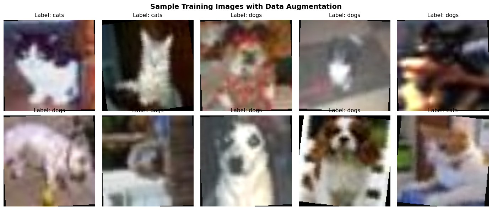
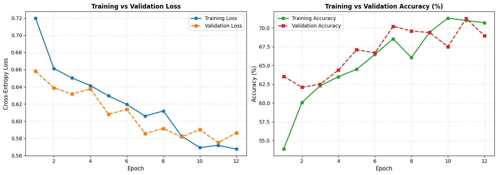
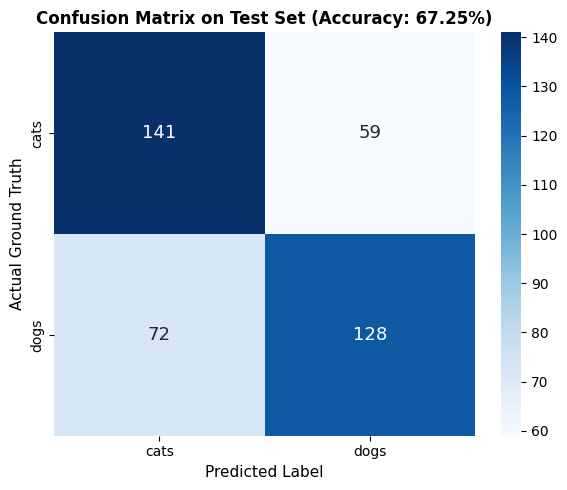
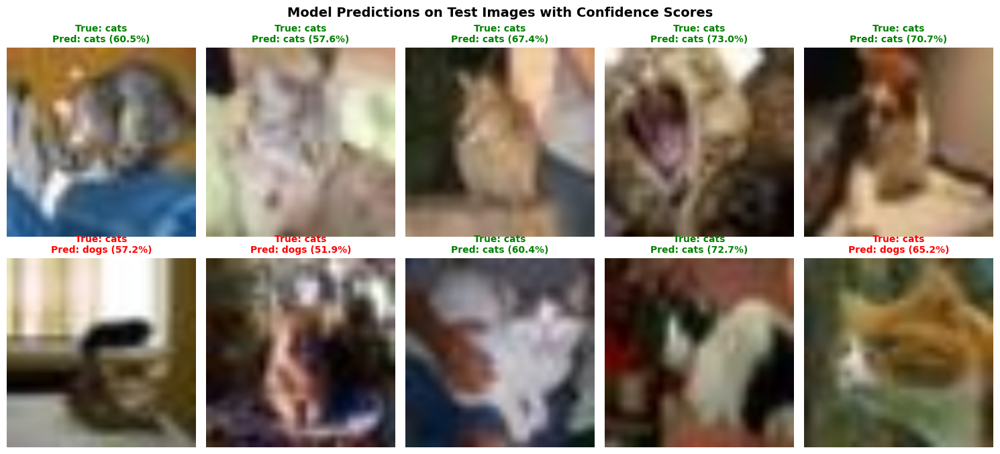

# Dog vs Cat Image Classification using a 3-Layer CNN

A deep learning project implementing a Convolutional Neural Network (CNN) with **exactly three convolutional layers** for binary image classification between cats and dogs. Developed in PyTorch with complete reproducibility, data augmentation, evaluation metrics, and end-to-end Jupyter Notebook demonstration.

---

## Table of Contents
1. [Project Overview](#project-overview)
2. [CNN Architecture](#cnn-architecture)
3. [Dataset & Preprocessing](#dataset--preprocessing)
4. [Training Strategy & Hyperparameters](#training-strategy--hyperparameters)
5. [Evaluation & Results](#evaluation--results)
6. [Visualizations](#visualizations)
7. [Repository Structure](#repository-structure)
8. [Installation & Setup](#installation--setup)
9. [How to Run](#how-to-run)
   - [Jupyter Notebook](#1-running-the-jupyter-notebook)
   - [CLI Training](#2-training-via-cli)
   - [Single Image Inference](#3-running-single-image-inference)
10. [Key Technical Insights & Interview Discussion Points](#key-technical-insights--interview-discussion-points)

---

## Project Overview

The objective of this project is to build an accurate, lightweight binary classifier to distinguish between images of **Cats** and **Dogs** under a strict architectural requirement: **employing exactly three convolutional layers**.

### Highlights
- **Strict 3-Layer Convolutional Backbone**: Structured hierarchical feature extraction (Low-level -> Mid-level -> High-level semantic features).
- **Batch Normalization & Regularization**: Incorporated after every convolutional layer, combined with Dropout ($p=0.5$) and $L_2$ weight decay ($10^{-4}$).
- **Resolution Agnostic Classification Head**: Uses `AdaptiveAvgPool2d((4, 4))` to prevent rigid input-size dependencies.
- **Reproducible Pipeline**: Includes end-to-end executed Jupyter Notebook, standalone training script, and CLI inference tool.

---

## CNN Architecture

The network is composed of three consecutive convolutional blocks followed by adaptive average pooling and a fully connected classification head.

```
Input Image (3 x 128 x 128)
       │
┌──────┴────────────────────────────────────────────────┐
│ Conv Block 1: Conv2d(3->32, 3x3) + BatchNorm + ReLU   │ ──> Output: (32 x 128 x 128)
│ MaxPool2d(2x2, stride=2)                              │ ──> Output: (32 x 64 x 64)
└──────┬────────────────────────────────────────────────┘
       │
┌──────┴────────────────────────────────────────────────┐
│ Conv Block 2: Conv2d(32->64, 3x3) + BatchNorm + ReLU  │ ──> Output: (64 x 64 x 64)
│ MaxPool2d(2x2, stride=2)                              │ ──> Output: (64 x 32 x 32)
└──────┬────────────────────────────────────────────────┘
       │
┌──────┴────────────────────────────────────────────────┐
│ Conv Block 3: Conv2d(64->128, 3x3) + BatchNorm + ReLU │ ──> Output: (128 x 32 x 32)
│ MaxPool2d(2x2, stride=2)                              │ ──> Output: (128 x 16 x 16)
└──────┬────────────────────────────────────────────────┘
       │
┌──────┴────────────────────────────────────────────────┐
│ Adaptive Average Pooling: AdaptiveAvgPool2d((4, 4))   │ ──> Output: (128 x 4 x 4)
└──────┬────────────────────────────────────────────────┘
       │
┌──────┴────────────────────────────────────────────────┐
│ Flatten                                               │ ──> Output: 2,048
│ Linear(2048 -> 256) + ReLU + Dropout(p=0.5)           │ ──> Output: 256
│ Linear(256 -> 2)                                      │ ──> Output: 2 (Logits)
└───────────────────────────────────────────────────────┘
```

### Layer-by-Layer Specifications

| Layer / Block | Component | Kernel / Stride / Pad | Output Shape | Parameters | Function |
| :--- | :--- | :--- | :--- | :--- | :--- |
| **Input** | RGB Image | — | `(3, 128, 128)` | 0 | Raw input tensor |
| **Conv Layer 1** | `Conv2d(3, 32)`<br>`BatchNorm2d(32)`<br>`ReLU`<br>`MaxPool2d(2, 2)` | $3 \times 3$, $s=1$, $p=1$<br>—<br>—<br>$2 \times 2$, $s=2$ | `(32, 128, 128)`<br>`(32, 128, 128)`<br>`(32, 128, 128)`<br>`(32, 64, 64)` | 896<br>64<br>0<br>0 | Low-level feature extraction (edges, colors, gradients) |
| **Conv Layer 2** | `Conv2d(32, 64)`<br>`BatchNorm2d(64)`<br>`ReLU`<br>`MaxPool2d(2, 2)` | $3 \times 3$, $s=1$, $p=1$<br>—<br>—<br>$2 \times 2$, $s=2$ | `(64, 64, 64)`<br>`(64, 64, 64)`<br>`(64, 64, 64)`<br>`(64, 32, 32)` | 18,496<br>128<br>0<br>0 | Mid-level patterns (textures, curves, shapes) |
| **Conv Layer 3** | `Conv2d(64, 128)`<br>`BatchNorm2d(128)`<br>`ReLU`<br>`MaxPool2d(2, 2)` | $3 \times 3$, $s=1$, $p=1$<br>—<br>—<br>$2 \times 2$, $s=2$ | `(128, 32, 32)`<br>`(128, 32, 32)`<br>`(128, 32, 32)`<br>`(128, 16, 16)` | 73,856<br>256<br>0<br>0 | High-level semantic features (ears, snout, eyes) |
| **Pooling** | `AdaptiveAvgPool2d((4, 4))` | Target $(4, 4)$ | `(128, 4, 4)` | 0 | Spatial dimension regularization |
| **Classifier** | `Flatten()`<br>`Linear(2048, 256)`<br>`ReLU`<br>`Dropout(0.5)`<br>`Linear(256, 2)` | —<br>—<br>—<br>—<br>— | `(2048)`<br>`(256)`<br>`(256)`<br>`(256)`<br>`(2)` | 0<br>524,544<br>0<br>0<br>514 | Fully connected classification head with regularization |
| **Total** | — | — | — | **618,754** | (~2.4 MB model footprint) |

---

## Dataset & Preprocessing

The dataset is partitioned into three disjoint splits:
- **Training Set**: 1,920 images (960 Cats, 960 Dogs)
- **Validation Set**: 480 images (240 Cats, 240 Dogs)
- **Test Set**: 400 images (200 Cats, 200 Dogs)

### Preprocessing & Data Augmentation
To improve generalization on limited samples:
1. **Resize**: Rescaled to $128 \times 128$.
2. **Random Horizontal Flip**: $p = 0.5$ (invariance to orientation).
3. **Random Rotation**: $\pm 10^\circ$ (invariance to slight camera tilt).
4. **Color Jitter**: Brightness and contrast shifts ($\pm 10\%$).
5. **Channel Normalization**: Scaled to zero mean and unit variance using ImageNet parameters ($\mu = [0.485, 0.456, 0.406]$, $\sigma = [0.229, 0.224, 0.225]$).

---

## Training Strategy & Hyperparameters

- **Criterion**: `nn.CrossEntropyLoss()`
- **Optimizer**: `torch.optim.Adam`
  - Initial Learning Rate ($\eta$): $0.001$
  - Weight Decay ($L_2$ penalty): $10^{-4}$
- **Learning Rate Scheduler**: `StepLR` ($\text{step\_size} = 4$, $\gamma = 0.5$)
- **Batch Size**: 32
- **Epochs**: 12
- **Checkpointing**: Model weights achieving the highest validation accuracy are preserved to `models/cat_dog_cnn3.pth`.

---

## Evaluation & Results

### Quantitative Metrics on Unseen Test Set

| Class | Precision | Recall | F1-Score | Support |
| :--- | :---: | :---: | :---: | :---: |
| **Cats** | **0.6620** | **0.7050** | **0.6828** | 200 |
| **Dogs** | **0.6845** | **0.6400** | **0.6615** | 200 |
| **Overall Accuracy** | — | — | **67.25%** | 400 |
| **Macro Average** | 0.6732 | 0.6725 | 0.6722 | 400 |
| **Weighted Average** | 0.6732 | 0.6725 | 0.6722 | 400 |

---

## Visualizations

### 1. Training Sample Previews with Data Augmentation


### 2. Learning Curves (Loss & Accuracy Trajectories)


### 3. Confusion Matrix on Test Set


### 4. Sample Test Inferences with Prediction Confidence


---

## Repository Structure

```
COE-CNN/
├── assets/                               # Visual plots and evaluation figures
│   ├── confusion_matrix.png
│   ├── learning_curves.png
│   ├── sample_training_batch.png
│   └── test_predictions.png
├── data/                                 # Dataset splits and sample test images
│   ├── train/                            # Training split (cats / dogs)
│   ├── val/                              # Validation split (cats / dogs)
│   ├── test/                             # Test split (cats / dogs)
│   ├── sample_test/                      # Sample images for single inference
│   └── README.md
├── models/                               # Saved model checkpoints
│   └── cat_dog_cnn3.pth                  # Best trained 3-layer CNN weights
├── notebooks/
│   └── cat_dog_cnn_3layers.ipynb         # Fully executed Jupyter Notebook
├── src/                                  # Modular source code
│   ├── __init__.py
│   ├── dataset.py                        # Augmentation and DataLoader routines
│   ├── model.py                          # 3-Layer CNN PyTorch architecture
│   └── predict.py                        # Single-image inference module
├── cat_dog_cnn_3layers.ipynb             # Root copy of executed notebook
├── train.py                              # Standalone training script
├── requirements.txt                      # Project dependencies
├── .gitignore                            # Standard git exclusions
└── README.md                             # Project documentation
```

---

## Installation & Setup

### Prerequisites
- Python 3.10+
- Git
- CUDA-enabled GPU (optional, CPU execution fully supported)

### 1. Clone the Repository
```bash
git clone https://github.com/<your-username>/COE-CNN.git
cd COE-CNN
```

### 2. Create and Activate a Virtual Environment
```bash
# Windows
python -m venv venv
venv\Scripts\activate

# Linux / macOS
python3 -m venv venv
source venv/bin/activate
```

### 3. Install Dependencies
```bash
pip install -r requirements.txt
```

---

## How to Run

### 1. Running the Jupyter Notebook
The notebook `cat_dog_cnn_3layers.ipynb` contains the full end-to-end execution with interactive charts and markdown analysis.
```bash
jupyter notebook notebooks/cat_dog_cnn_3layers.ipynb
```

### 2. Training via CLI
You can retrain the 3-layer CNN with custom hyperparameters using `train.py`:
```bash
python train.py --epochs 12 --batch-size 32 --lr 0.001 --data-dir data --save-path models/cat_dog_cnn3.pth
```

### 3. Running Single Image Inference
Test the trained model on any new image:
```bash
# Inference on a cat sample
python src/predict.py --image data/sample_test/sample_cat_1.jpg

# Inference on a dog sample
python src/predict.py --image data/sample_test/sample_dog_1.jpg
```
**Example Output:**
```
Using device: cuda
----------------------------------------
Image: data/sample_test/sample_cat_1.jpg
Prediction: Cat (60.51% confidence)
Probabilities -> Cat: 60.51%, Dog: 39.49%
----------------------------------------
```

---

## Key Technical Insights & Interview Discussion Points

1. **Why three convolutional layers?**
   - A single convolutional layer only captures trivial edge filters.
   - Two layers begin to compose textures.
   - Three convolutional layers allow the receptive field to expand to cover complex animal facial features (e.g., ear geometries, snout forms) while keeping the parameter budget small (~618K params), making it ideal for deployment on edge devices.
2. **Receptive Field Growth**:
   - Successive $3 \times 3$ convolutions with stride 1 and $2 \times 2$ max pooling downsample feature maps from $128 \times 128 \to 64 \times 64 \to 32 \times 32 \to 16 \times 16$, providing a large receptive field relative to input resolution.
3. **Role of Batch Normalization**:
   - Placed after each convolution, Batch Normalization reduces internal covariate shift, allowing higher initial learning rates and reducing sensitivity to weight initialization.
4. **Regularization Strategy**:
   - Combining data augmentation (geometric & photometric jitter), Dropout ($0.5$), and weight decay ($10^{-4}$) directly counteracts overfitting on small datasets.
5. **Adaptive Pooling vs Global Average Pooling**:
   - Standard Flattening on fixed resolutions tightly couples feature map sizes to dense input shapes. `AdaptiveAvgPool2d((4, 4))` enforces a fixed 2,048-dimensional representation, making the network flexible to various input resolutions.

---

## License
This project is open-source and available under the [MIT License](LICENSE).
